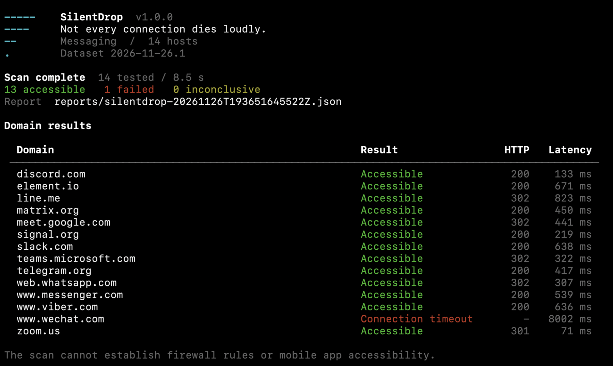

# SilentDrop


*Not every connection dies loudly.*

[](https://github.com/akram-jemal/silentdrop/actions/workflows/ci.yml)
[](LICENSE)

SilentDrop is a Python CLI for diagnosing website reachability from the network
you're on. It probes a bundled set of public hostnames and records DNS,
connection, TLS and HTTP outcomes. Use it to investigate a timeout,
verify that an endpoint responded, or compare observations across networks.

## Quick start

Use Python 3.10 or later. Clone the repository or extract the source ZIP, then
open a terminal in the folder containing `pyproject.toml`. [Download the v1.1.0 source](https://github.com/akram-jemal/silentdrop/archive/refs/tags/v1.1.0.zip)

```sh
python3 -m venv .venv
source .venv/bin/activate
python -m pip install .
silentdrop scan --category messaging
```

On Windows, create the environment with `py -m venv .venv` and activate it in
PowerShell with `.\.venv\Scripts\Activate.ps1`. You can also invoke the CLI with
`python -m silentdrop`.

A scan saves a timestamped JSON report under `reports/` in the current working
directory by default. Use SilentDrop where you are authorized to send direct
HTTPS probes.

## Terminal demo

A messaging scan from v1.0.0 on macOS. Thirteen of the fourteen hosts answered the probe,
and one timed out.



<details>
<summary>Text excerpt</summary>

```text
-----    SilentDrop  v1.0.0
----     Not every connection dies loudly.
--       Messaging  /  14 hosts
.        Dataset 2026-11-26.1

Scan complete  14 tested / 8.5 s
13 accessible   1 failed   0 inconclusive

Domain                     Result                 HTTP   Latency
discord.com                Accessible              200    133 ms
meet.google.com            Accessible              302    441 ms
www.wechat.com             Connection timeout        -   8002 ms
zoom.us                    Accessible              301     71 ms
```

</details>

## Common tasks

| Task | Command |
| --- | --- |
| Inspect Python's TLS trust and detected proxy settings offline | `silentdrop doctor` |
| Check direct HTTPS connectivity to one bundled hostname | `silentdrop doctor --probe` |
| List category names and host counts | `silentdrop categories` |
| Show the bundled dataset version and source | `silentdrop dataset info` |
| Scan every bundled hostname | `silentdrop scan` |
| Scan a category and save CSV | `silentdrop scan --category social --output reports/social.csv` |
| Show only failed probes in the results table | `silentdrop scan --category gaming --failed-only` |
| Compare two bundled example reports offline | `silentdrop compare examples/synthetic-home.json examples/synthetic-lab.json` |

SilentDrop sends a direct HTTPS `HEAD /` request and verifies TLS. A 2xx or 3xx
response means that the original hostname answered the probe. Site policies,
network conditions and client trust settings can all affect the result.
Firewall policy, redirect destinations and mobile app access are outside the
scope of the probe.

## Documentation

- Scan options, setup diagnostics, exit codes and troubleshooting. [Operating guide](docs/usage.md)
- JSON and CSV fields, comparison behavior and example reports. [Report reference](docs/reports.md)
- Development setup, code layout and validation checks. [Contributing](CONTRIBUTING.md)
- Dataset provenance, licensing and update procedure. [Dataset attribution](silentdrop/data/ATTRIBUTION.md)
- Release history and changes on the development branch. [Changelog](CHANGELOG.md)

## License

The code uses the MIT license. The bundled dataset uses CC BY-NC-SA 4.0.
[Code license](LICENSE) · [Dataset license](silentdrop/data/ATTRIBUTION.md)
